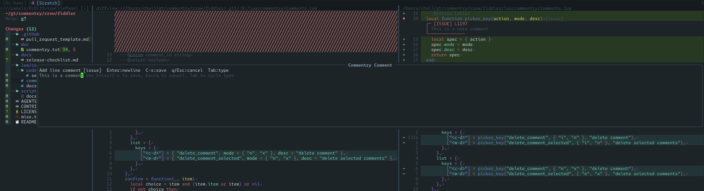

# commentry.nvim

Neovim plugin for a project-scoped conversation inbox, local diff reviews,
persisted comments, and optional agent handoff.

## Universal inbox

The first inbox implementation works independently of Diffview and Snacks:

- `:Commentry comment` captures the current file line and opens a multiline
  comment editor. `:'<,'>Commentry comment` captures a visual line range.
- `:Commentry capture-text` comments on text from the unnamed register.
  `:Commentry capture-text +` uses the system clipboard when a clipboard
  provider is available.
- `:Commentry inbox` opens the current project's threads with a focused diff
  beside the selected conversation. `:Commentry inbox all` shows all projects.
- `:Commentry new-thread` starts a project conversation with no selection,
  clipboard contents, or file anchor. Press `n` inside the inbox for the same action.

The editor uses `Ctrl-s` to save and normal-mode `q` to cancel. The inbox uses
`j`/`k` in its list to select a thread, `r` to reply, `x` to resolve or reopen,
`c` to choose a comparison, `e` to expand or collapse surrounding code,
`i` to inspect capture and Git details, `?` for help, `R` to refresh,
and `q` to close. `Ctrl-h/j/k/l` moves between panels. Plain `h/j/k/l` retains
normal text navigation. Closing an inbox panel with a native window command
closes the inbox view; `:Commentry inbox` opens it again.
Source and conversation stack below 140 editor columns
and sit side by side at larger widths. The layout adapts when resized. No
global maps or colorscheme overrides are added. Open Commentry in your normal
Neovim configuration to use your theme and configured integrations.

### Read state and filters

`*` marks unread activity. Messages and comparisons authored by anyone other
than the local `You` label are incoming activity. Own replies do not clear unread
messages. List previews leave unread state intact. `Enter`, or moving into the
conversation panel, marks the displayed activity read. Agent comparisons appear
as labeled attachments with instructions for viewing them using `c`.
A newer concurrent reply
stays unread. `u` explicitly toggles read/unread. Agent CLI reads never consume
the human reader's unread state.

Press `f` for all, unread, read, open, resolved, or queued filters. Commands such
as `:Commentry inbox unread` open a project filter directly. `:Commentry inbox
all` still selects all projects; use `f` to filter that scope. A thread opened
from the unread filter remains visible while you read it. `R` or changing filters
reapplies the filter. External writes refresh approximately every 1.5 seconds
while the inbox is active in normal mode, retaining the selected thread and
scroll position. `R` also refreshes comparisons after source edits.

### Existing agents through Rex

The inbox sends requests to Pi or Codex already running in Rex. Press `S` to
select an agent in the current project. Rex supplies discovery, process identity,
status and terminal delivery. The harness manages its own native queue.
Sidekick only handles the separate legacy `:Commentry send-to-agent` command.
No `agent.enabled` setting is required for the inbox.

Load the reusable actions in Rex `init.lua` and run `rex config reload`:

```lua
dofile(os.getenv("HOME") .. "/plugins/commentry.nvim/integrations/rex/agents.lua").setup()
```

The actions work independently of Commentry:

```bash
rex do agent_list
rex do agent_list project=/absolute/project/path
rex do agent_get target='TARGET_ID_FROM_LIST'
rex do agent_queue target='TARGET_ID_FROM_LIST' text='Review this change'
rex do agent_steer target='TARGET_ID_FROM_LIST' text='Also check cancellation'
rex do agent_read target='TARGET_ID_FROM_LIST'
rex do agent_focus target='TARGET_ID_FROM_LIST'
```

Targets from `agent_list` identify the Rex session, pane and foreground process.
A restarted or replaced agent requires selecting its new target. `agent_list`
filters directories by the supplied absolute path and its descendants.
Commentry additionally resolves Git roots when selecting project agents.
`agent_get` reports the current status. `agent_read` returns terminal text,
not a structured conversation transcript. OpenCode is not implemented.

The composer uses `Ctrl-s` to save and `Ctrl-d` to save and send. Press `m` to
choose queue or steer, then `s` to send the selected thread. Both modes submit
immediately, including while the agent is working:

| Harness | Queue | Steer |
| --- | --- | --- |
| Codex | Tab | Enter |
| Pi | Alt-Enter | Enter |

Queue uses the harness's native follow-up behavior. Steer uses its direct
submission behavior. When idle, the harness can begin processing immediately.
There is no Commentry worker waiting for idle and no new agent session.
Messages use bracketed paste and the submission key in one terminal write.
This uses the existing composer, so it should be clear of unfinished drafts.
Blocked, unknown and error states require attention before delivery. Status
reports must identify the foreground process. Approvals stay in the agent UI.

For customized harness keybindings, pass adapters to `setup` instead of using
its defaults. Values are terminal byte sequences:

```lua
dofile("/path/to/agents.lua").setup({
  adapters = {
    codex = { queue = "\t", steer = "\r" },
    pi = { queue = "\27\r", steer = "\r" },
  },
})
```

Commentry retains immutable request snapshots, thread IDs and claim IDs for
reply attribution. Delivered requests include instructions for `commentry finish`
or JSON RPC. This saves the answer and completes the specific claim atomically.
Pending means locally waiting for delivery. Sent means submitted to the harness.
Terminal writes and status changes do not automatically complete a request.
Completion does not resolve a conversation. Agents can attach focused comparisons
while preserving the original capture.

Sending an unchanged active request shows "Nothing new to send. There are no
new messages."
With no selected agent, requests remain locally pending. Selecting an agent or
using `a` to deliver pending requests sends them to its native queue. Press `a`
for status, focus, selection and detach. Detaching leaves delivered work intact.
A failed or partial write is never replayed automatically. Inspect the agent
before retrying with `t`. Sending the same failed snapshot keeps its failure
visible. A late agent answer can still finish its original claim until that
request is explicitly retried. Cancelling an inbox claim does not remove work already
submitted to the harness's native queue.

```bash
commentry agent --project . list
commentry agent --project . attach 'TARGET_ID_FROM_LIST'
commentry agent --project . status
commentry agent --project . dispatch
commentry agent --project . steer t-THREAD
commentry agent --project . detach
commentry retry t-THREAD --queue-id e-REQUEST
commentry finish t-THREAD --claim-id claim-ID --author codex --body 'Reply'
```

Agent payloads retain original selection coordinates. `excerpt_first` identifies
the original file line represented by `lines[0]` in a focused excerpt.

### Clipboard capture through Rex

Install the binary with `mise run install-commentry`, then load
`integrations/rex/commentry.lua` from your Rex `init.lua`:

```lua
dofile(os.getenv("HOME") .. "/plugins/commentry.nvim/integrations/rex/commentry.lua")
rex.bind("ctrl+a>a", "commentry_capture")
rex.bind("ctrl+a>shift+a", "commentry_new")
rex.bind("ctrl+a>i", "commentry_inbox")
```

The actions also appear in Rex's command palette. `commentry_capture` snapshots
the macOS clipboard immediately, infers the project from the originating pane's
directory, and opens a temporary **New comment** tab. The tab shows the
captured text above a multiline editor. `Ctrl-p` changes the project, `Ctrl-s`
saves, `Ctrl-d` saves and queues, and normal-mode `q` or `:q` cancels. Saving or
cancelling returns to the originating tab. Failed saves retain the draft.
If sending fails after saving, the editor stays open with delivery guidance.
`Ctrl-s` closes the saved capture. Inspect the inbox before retrying delivery.
`commentry_new` opens the same editor without a clipboard attachment.
`commentry_inbox` reuses Neovim in the current pane or an immediately adjacent
pane on either side in the same Rex window. Otherwise it creates a pane to the
right and starts Neovim there. Existing editors receive the inbox through RPC
when available. Editors without a listener receive a Normal-mode command.
Both paths preserve unsaved buffers
and their working directory.
Invoking from a recognized agent pane selects that existing agent for the
project inbox, without submitting pending requests. The equivalent shell
command is `commentry rex inbox`.
The editor uses your normal Neovim configuration and theme.
The Lua entry point also accepts an explicit project with
`require("commentry.inbox").open(nil, { project = "/path/to/project" })`.

From a shell, use `commentry capture --project .`, or add `--empty` for a
standalone conversation. `commentry rex capture` opens a temporary tab when
`REX_SESSION` and `REX_BLOCK` identify the origin. `--client` selects the Rex
app explicitly when needed. Set `COMMENTRY_REX` to override the Rex executable.
This first capture integration is local to macOS and uses Neovim 0.10+ as its
editor. The Rex keybind applies while Rex is focused; it is not an OS-wide hotkey.

The list shows titles above compact location/status labels. Diffs show original
and current line numbers with theme-linked addition and deletion highlights.
Conversations emphasize authors and message bodies; detailed provenance is
available through `i`. Surrounding code expands from four to sixteen lines
with `e`. Highlight groups use the `CommentryInbox` prefix and inherit the
active colorscheme.

File captures preserve the entire buffer, including unsaved changes, the exact
selected range, and available Git HEAD, branch, and original blob identity.
The source pane compares the surrounding region with the current buffer or
file. Changes above the selected region are accounted for. When the selected
code changes, the thread remains in the list with an `Outdated` label and an
explicitly approximate diff. Missing files retain the original excerpt.
Original captures remain available through `c`. Resolution and location state
are independent. Complex moves can require an agent-authored comparison.

Projects use the canonical Git worktree root, or the containing directory
outside Git. Inbox scope is project-wide across branches. Captured branch
information is provenance, not a filter. Separate worktrees currently have
separate project scopes.

### Capture and agent replies outside Neovim

Build the Go backend with `mise run build`, or install it with
`mise run install-commentry`. The inbox requires this binary. Neovim uses the
checkout's `bin/commentry` first, then `commentry` on PATH. `COMMENTRY_CLI` can
select an explicit executable.

`commentry rpc` reads one JSON request from standard input and returns one JSON
response. `scripts/commentry-inbox` forwards to that binary. Neither interface
requires Neovim to run.
Use an absolute project directory to choose a project, or omit it on creation
to use the invoking directory. For example, from this checkout:

```bash
./scripts/commentry-inbox <<'JSON'
{"action":"create","title":"Explain this output","text":"Found two matching excerpts.","body":"Show both candidate locations."}
JSON
```

The response contains `{"ok":true,"result":"t-..."}`. Use that returned ID:

```json
{"action":"list","project":"/absolute/project/path"}
{"action":"read","thread":"t-..."}
{"action":"reply","thread":"t-...","author":"Agent","body":"Here are the two candidates."}
{"action":"comparison","thread":"t-...","author":"Agent","label":"Split implementation","before":"old code\n","after":"new code\n"}
{"action":"resolve","thread":"t-...","resolved":true}
{"action":"list","project":"/absolute/project/path","filter":"unread","summary":true}
{"action":"read-state","thread":"t-...","read":true,"seen":"e-incoming-version-from-read"}
{"action":"queue","thread":"t-..."}
{"action":"claim","project":"/absolute/project/path","author":"Agent"}
{"action":"complete","thread":"t-...","claim_id":"claim-..."}
{"action":"cancel","thread":"t-...","queue_id":"e-queued-request"}
```

Omit `project` from `list` to list every project. Comparison text is recorded
verbatim. Select `agent` with `c` to view the latest attached comparison, labeled
with its author and timestamp. This never overwrites the original capture or
edits source files. Authors are caller-provided labels. Failed requests return
`ok: false` and exit nonzero. `summary: true` excludes full buffer snapshots from
list output. Claims are serialized and project-scoped; a claim returns an
immutable message and a claim ID. Completing it does not resolve its thread.
Cancelled work cannot later be completed. SQLite transactions serialize claims
and recover unfinished writes after a crash. A committed claim remains visible
until completed, explicitly cancelled, or explicitly marked failed after uncertain delivery. It is never automatically reassigned.

The SQLite database lives at `stdpath("data")/commentry/inbox/inbox.sqlite3`.
The standalone CLI defaults to `$XDG_DATA_HOME/nvim/commentry/inbox` or
`~/.local/share/nvim/commentry/inbox`, respecting `NVIM_APPNAME`. Set
`COMMENTRY_INBOX_DIR` or pass `--directory` to select another inbox. Neovim
always passes its actual data directory to the backend. Replies, read state,
comparisons, queue transitions, and change records commit transactionally.
The database uses WAL with a five-second busy timeout. Corrupt databases and
unsupported schema versions report errors. There is no deletion interface yet.
Earlier prototype event files are left untouched and are not imported.

The same operations have shell commands with JSON output:

```bash
./bin/commentry create --project . --title 'Explain this' --body 'How does this work?'
./bin/commentry list --project . --filter unread --summary
./bin/commentry reply t-THREAD --author Codex --body 'Here is the explanation.'
./bin/commentry queue t-THREAD
./bin/commentry claim --project . --author Codex
./bin/commentry complete t-THREAD --claim-id claim-CLAIM
./bin/commentry comparison t-THREAD --author Codex --label 'Updated code' --before-file old.lua --after-file new.lua
./bin/commentry watch --project . --after 0 --timeout 60s
```

`watch` streams JSON lines containing committed changes, an opaque integer
`cursor`, and the latest `revision`. It emits an initial page, then waits for
activity until interrupted or the optional timeout expires. Resume with
`--after CURSOR`, using a cursor from the same database. `changes --after CURSOR`
returns one page of up to 100 changes. `revision` reads the latest sequence.
The equivalent JSON requests use `action: "changes"` with `cursor`, or
`action: "revision"`. Reading threads and watching changes never marks them read.
Use `read-state --read --seen e-VERSION` to acknowledge the version displayed,
or `read-state --read=false` to mark unread. Author labels are not authentication.
Neovim detects committed revisions automatically while the inbox is idle.

The existing Diffview review store and send-to-agent flow remain separate.
Review-to-inbox linking, OpenCode support, anchor reattachment, branch comparison
mode, and an OS-wide capture shortcut are follow-up work.
Removing the new inbox directory resets only the inbox data. Existing review
drafts remain in their original store.

## Preview

Commentry inside Diffview with draft comments, type labels, and review context
visible in-place:



## Install

Using lazy.nvim with Diffview+:

```lua
{
  "commentry/commentry.nvim",
  dependencies = {
    "dlyongemallo/diffview-plus.nvim",
  },
  opts = {},
}
```

The upstream `sindrets/diffview.nvim` package is also supported. Install only
one implementation; both expose the same `diffview` module and commands.

Required:

- Neovim `0.10+`
- `dlyongemallo/diffview-plus.nvim` or `sindrets/diffview.nvim` for Diffview reviews.
  The universal inbox does not require either implementation.

Optional integrations:

- `folke/snacks.nvim` for `:Commentry list-comments` and `:Commentry reattach`
- a Sidekick runtime for `:Commentry send-to-agent`

## Setup

```lua
require("commentry").setup({
  log = {
    level = "warn", -- error|warn|info|debug
    sink = "notify", -- notify|echo|file
    file = nil, -- path when sink == "file"
  },
  diagnostics = {
    open_style = "split", -- split|vsplit|float
  },
  agent = {
    enabled = false,
  },
  diffview = {
    auto_attach = true,
    comment_cards = {
      max_width = 76,
      max_body_lines = 6,
      show_markers = true,
    },
    comment_ranges = {
      enabled = true,
      line_highlight = true,
    },
  },
})
```

## Commands

`commentry.nvim` provides a `:Commentry` command with subcommands.

- `:Commentry open` opens a diffview for local changes (shortcut).
- `:Commentry add-range-comment` creates a range comment from the current visual selection.
- `:Commentry list-comments [active|unresolved|all]` opens a Snacks picker for draft comments across the current review. The file preview renders active comments with the same cards and range marks as Diffview. The default is `active`; unresolved rows include the stale anchor and reason. Delete the current or selected drafts with `<C-d>` / `<M-d>`. Requires `snacks.nvim`.
- `:Commentry reattach` reattaches a selected unresolved comment at the current diff line. A command range such as `:'<,'>Commentry reattach` uses that exact destination range; normal invocation preserves the comment's previous range length.
- `:Commentry help` opens the native `commentry` vimdoc.
- `:Commentry set-comment-type` sets default or per-comment type (`note`, `suggestion`, `issue`, `praise`, `question`).
- `:Commentry toggle-file-reviewed` toggles reviewed status for the current file's exact displayed change.
- `:Commentry next-unreviewed` jumps to the next unreviewed diff entry in panel order.
- `:Commentry export` prints deterministic markdown for active draft comments.
- `:Commentry export register` writes markdown to the unnamed register.
- `:Commentry export register:<name>` writes markdown to a specific register (for example `register:a`).
- `:Commentry debug-store` prints the active review context and the exact on-disk store path.
- `:Commentry diagnostics` opens a scratch buffer with runtime diagnostics (config/log/store/diffview state).
- `:Commentry send-to-agent` delegates the current review payload to Sidekick. Requires `agent.enabled = true`.

## Agent Harness Handoff

Commentry delegates agent selection and lifecycle to `require("sidekick.cli").send()`.
Sidekick reuses an attached agent when possible; otherwise it opens its CLI
selector and can attach to an existing session or start a new one. Commentry
does not maintain a separate session inventory or picker.

Sidekick owns the supported-agent list, so Commentry remains provider agnostic.
Enable agent handoff with:

```lua
require("commentry").setup({
  agent = {
    enabled = true,
  },
})
```

`:Commentry send-to-agent` leaves the Sidekick tool filter unset, so Sidekick
chooses among any configured agent harnesses.

If you open diffview directly (for example `:DiffviewOpen main`), Commentry will
auto-attach to diff buffers by default.

You can disable auto-attach with:

```lua
require("commentry").setup({
  diffview = {
    auto_attach = false,
  },
})
```

## Keymap Configuration

Commentry supports nine configurable diffview-local keymap actions:

| Action | Default | Mode | Empty-string disable (`""`) | Command fallback |
| --- | --- | --- | --- | --- |
| `add_comment` | `mc` | Normal | No | None |
| `add_range_comment` | `mc` | Visual | No | `:Commentry add-range-comment` |
| `edit_comment` | `me` | Normal | No | None |
| `delete_comment` | `md` | Normal | No | None |
| `set_comment_type` | `mt` | Normal | No | `:Commentry set-comment-type` |
| `toggle_file_reviewed` | `mr` | Normal | Yes | `:Commentry toggle-file-reviewed` |
| `next_unreviewed_file` | `]r` | Normal | Yes | `:Commentry next-unreviewed` |
| `send_to_agent` | `ms` | Normal | No | `:Commentry send-to-agent` |
| `list_comments` | `ml` | Normal | No | `:Commentry list-comments` |

Notes:

- Keymaps attach only in buffers marked as Commentry diffview buffers.
- Empty-string disable is intentionally scoped to `toggle_file_reviewed` and `next_unreviewed_file`.
- For remap-only actions (`add_comment`, `add_range_comment`, `edit_comment`, `delete_comment`, `set_comment_type`, `send_to_agent`, `list_comments`), `""` is invalid and setup warns, then default/effective mapping remains active.
- `add_range_comment` mapping normally uses its configured/default value from setup normalization. The fallback chain to resolved `add_comment` (then `mc`) is a defensive runtime path when `Config.keymaps` is missing or bypasses normalization.

Example override (partial remap + selective disable):

```lua
require("commentry").setup({
  keymaps = {
    add_comment = "gc",
    add_range_comment = "gc",
    edit_comment = "ge",
    delete_comment = "gd",
    set_comment_type = "gt",
    send_to_agent = "gs",
    list_comments = "gl",
    toggle_file_reviewed = "",
    next_unreviewed_file = "]u",
  },
})
```

Example keep defaults except one mapping:

```lua
require("commentry").setup({
  keymaps = {
    next_unreviewed_file = "]n",
  },
})
```

## Development

- Install development tools: `mise install`
- Format Lua and Go: `mise run format`
- Lint Lua and Go: `mise run lint`
- Run Lua and Go tests: `mise run test`
- Validate docs: `mise run docs`
- Full local checks: `mise run ci`
- Build the standalone Go CLI: `mise run build`
- Run its help: `mise run run -- --help`
- Install it to `~/.local/bin/commentry`: `mise run install-commentry`
- First release checklist: `docs/release-checklist.md`
- Canonical feature/design plans: `docs/plans/`
- Legacy Speckit archive (read-only history): `docs/archive/speckit/`

The Go CLI owns the SQLite inbox backend, JSON protocol, and shell commands.
Go tooling is adapted from `~/personal/evaler`,
including Go 1.26.5, golangci-lint v2, its lint and formatter rules, hk 1.55,
and the Cobra/Viper skill in `.agents/skills/cobra-viper`.
The backend uses the pure Go `modernc.org/sqlite` driver. Viper is not needed yet.
Lua tests build the backend automatically. `mise run build_go` compiles it without
running checks.

Use `mise run format_go`, `mise run lint_go`, and `mise run test_go` for Go-only
work. `mise run lint:fix` applies Go lint fixes through hk. Install the optional
git hooks with `mise exec -- hk install`.

## Behavior Notes

- Draft comments are persisted per review context under `~/.commentry/repos/<repo>/contexts/<context-id>/`.
- Review context identity is branch-scoped (`<root>::review::branch::<branch-name>`), so comments remain stable across
  different `:DiffviewOpen` range lenses on the same branch until anchors become outdated by code changes.
- Add/edit/range comment actions open a floating multiline editor (`Enter` for newline, `Ctrl-s` to save, `q`/`Esc` in normal mode to cancel, `Tab` to cycle type).
- Draft comment bodies are rendered as persistent boxed cards on commented lines, even when the cursor moves away.
- Range comments render start/mid/end gutter signs (`╭`, `│`, `╰`) with subtle line tinting to show covered lines.
- Reviewed state is content-addressed from each file's base/head Git blob and mode identities. It survives unstaged -> staged -> committed -> pushed transitions when the displayed before/after content is unchanged, regardless of commit IDs or Diffview range syntax.
- A file is unreviewed when either displayed endpoint changes. Returning to an exact previously reviewed before/after snapshot restores its reviewed state.
- Commentry renders `[reviewed]` marks in the Diffview file panel, `[partial]` on partially reviewed directories, per-file active comment counts, and separate unresolved counts. When several states share a narrow panel row, the compact badge uses `R` (reviewed), `c` (active comments), and `u` (unresolved), for example `[R 2c 1u]`. A lightweight `[reviewed]` / `[unreviewed]` indicator also appears in active diff buffers. These marks are independent from Diffview+ batch selections.
- When code changes invalidate an anchor, the draft remains persisted with an unresolved reason instead of being exported or sent. Use `:Commentry list-comments unresolved` to inspect or permanently delete it, or move to the new destination and run `:Commentry reattach`.
- Send flow is explicit: open/attach a review (`:Commentry open` or auto-attach), enable the generic agent integration, then run `:Commentry send-to-agent`.
- Sidekick owns agent selection, attachment, terminal creation, display/focus, and prompt submission. Commentry only builds the review payload and delegates it.
- Agent sends require an active Commentry review context. Running them outside an attached review buffer/context fails.
- Send is send-and-forget in v1: Commentry delegates a compact human-readable payload (`COMMENTRY_REVIEW_V1`) once and reports whether delegation started. Sidekick owns subsequent selection or cancellation.
- v1 does not persist send history, delivery receipts, retries, or any outbound queue state.

## Bug Reports

Use the minimal repro config to isolate issues:

```bash
nvim --clean -u repro.lua
```

This bootstraps a clean Neovim with only commentry + diffview loaded.

## Troubleshooting

- Draft store file does not exist yet:
  Commentry creates `~/.commentry/repos/<repo>/contexts/<context-id>/commentry.json` lazily on first successful write
  (add/edit/delete comment, set type, toggle reviewed). If no writes happened in that context yet, the file is absent.
- `:Commentry list-comments` is unavailable:
  install `snacks.nvim`, then rerun `:checkhealth commentry` to confirm `picker.select` support.
- Incompatible pre-snapshot store:
  reviewed-file persistence now uses `reviewed_changes` snapshots rather than the former `file_reviews` boolean map. Remove the context's `commentry.json` if it predates this format.
- Wrong context:
  review context is branch-scoped (`<root>::review::branch::<branch-name>`) and shared across diff ranges on that branch.
  Use `:Commentry debug-store` to confirm the active context id/path.
- Comment disappeared after unstaged code changed:
  anchor reconciliation keeps the draft but marks it unresolved. Run `:Commentry list-comments unresolved` to inspect or delete it. To recover it, move to the replacement line and run `:Commentry reattach`.
- Agent handoff is unavailable:
  confirm Sidekick is installed, run `:Commentry send-to-agent` from an active review context, and use Sidekick's selector to attach to or start an agent.
